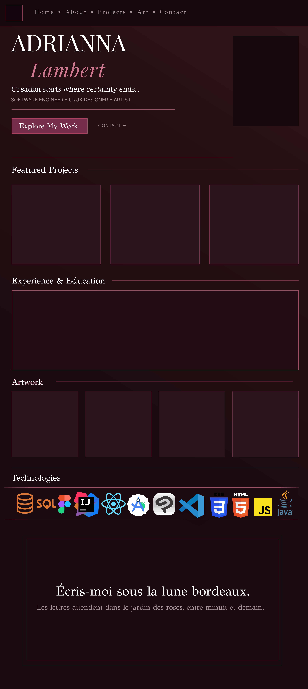
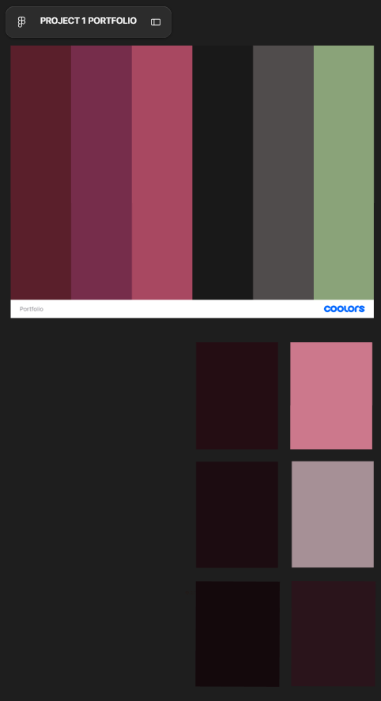

# Adrianna Lambert | Personal Portfolio Website

**Live Site:** https://adriannall.github.io/Portfolio/
**Repository:** https://github.com/AdriannaLL/Portfolio

> *Creation starts where certainty ends...*

---

## Table of Contents
1. [Project Overview](#project-overview)
2. [Target Audience](#target-audience)
3. [Content Strategy](#content-strategy)
4. [Information Organization](#information-organization)
5. [Visual Design](#visual-design)
6. [Interaction / Functionality](#interaction--functionality)
7. [Technical Overview](#technical-overview)
8. [Timeline / Project Milestones](#timeline--project-milestones)
9. [References & Learning Resources](#references--learning-resources)
10. [License](#license)

---

## Project Overview

This is my personal portfolio website, built from scratch using only HTML, CSS, and JavaScript. It represents me as a software developer, UI/UX designer, and artist, and brings my projects, experience, education, technical skills, and artwork together in one place. The site uses a dark, elegant design built around a deep burgundy color palette, which reflects my personal style while staying clean, organized, and professional.

---

## Target Audience

**Primary audience:** Recruiters and hiring managers looking for new grad software engineers. I graduate in December 2026, so the site is focused on helping employers quickly understand who I am, what I have built, and how to contact me.

**Secondary audience:** Professors, classmates, peers in tech, and potential collaborators interested in my development and design work.

---

## Content Strategy

### Part 1: Content

**1. What is your full name as you want it displayed professionally?**
Adrianna Lambert

**2. What is the purpose of your portfolio website?**
The purpose of my portfolio is to present myself professionally as I graduate and enter the tech industry. It gives employers one central place to see my projects, technical skills, education, experience, and creative work, along with easy ways to contact me and view my resume.

**3. Who is the target audience?**
My main audience is employers and recruiters hiring for software engineering roles. My secondary audience is professors, peers, and potential collaborators.

**4. What skills do you want to highlight?**
Software development, front end development, UI/UX design, object-oriented programming in Java, and mobile app development with React Native. I also want to highlight my artistic background and eye for detail, since it shapes how I design interfaces.

**5. What projects or work will you showcase?**
- **FSC Valet:** A desktop valet parking management app built as a team project for Farmingdale State College using Java, JavaFX, Spring Boot, and Firebase. I focused on front end development, UI design, navigation, styling, testing, and integration, and created original hand-drawn visual assets and logos.
- **EZ Healthcare:** A user-friendly healthcare management app for older adults, people with disabilities, and less tech-savvy users, focused on accessibility, simple navigation, and readable interfaces. I work on UX, programming, and documentation.
- **Aligned:** A faith-based mobile app for daily inspiration, goals, and personal growth, built with React Native and Expo.
- **Chopped:** A lighthearted app built just for fun, as a reminder not to take life too seriously. Built with React Native.
- **Artwork:** A gallery of my character design and illustration work.

**6. How will you describe yourself in a short professional bio?**
I'm a Computer Programming and Information Systems student at Farmingdale State College, graduating in December 2026. I build apps and interfaces with a focus on clean design, accessibility, and how things feel to actually use. Art has always been a part of how I work, and I like to bring that same eye for detail into every interface I build.

**7. What pages will your site include?**
The site is a single-page portfolio. The navigation bar scrolls to each section:
- Home
- About Me
- Featured Projects
- Experience & Education
- Artwork
- Technologies
- Contact

**8. What is your career goal or desired role?**
My goal is a new grad software engineering role. I am open to all types of software engineering positions, including front end, full stack, mobile, and UI/UX focused roles.

**9. What technologies or tools do you have experience with?**
- **Languages:** Java, Kotlin, Python, JavaScript, SQL, HTML, CSS
- **Frameworks & Technologies:** Spring Boot, React, React Native, Expo, JavaFX, Firebase, Node.js, Maven
- **Databases:** SQL (relational), NoSQL
- **Developer & Design Tools:** Git, GitHub, Figma, IntelliJ IDEA, Android Studio, VS Code, Clip Studio Paint

**10. What achievements or experiences are worth highlighting?**
- B.S. in Computer Programming & Information Systems at Farmingdale State College, graduating December 2026 with a 3.6 GPA
- A.A.S. in Information Technology from Nassau Community College
- Code Coach at TheCoderSchool, teaching foundational programming using Python and Scratch
- Tech Assistant / Client Support at Lambert Painting and Renovation, providing IT support for daily business operations
- Front end and UI design work on the FSC Valet team project, including original hand-drawn assets and logos

**11. What call-to-action should visitors take?**
The main call-to-action is **"Explore My Work,"** which takes visitors to my projects. The secondary actions are contacting me by email, viewing my GitHub and LinkedIn, and opening my resume.

**12. Will you include a resume? In what format?**
Yes. My resume is included as a PDF that opens in a new tab from the Resume button in the navigation bar and in the contact section.

**13. What social or professional links will you include?**
- GitHub: https://github.com/AdriannaLL
- LinkedIn: https://www.linkedin.com/in/adrianna-lambert-59248430a/
- Email: adriannal.lambert@gmail.com

---

## Information Organization

The site is one scrolling page. Each section is numbered with Roman numerals (I to VI) so visitors always know where they are and the page reads in a clear order.

```
index.html
│
├── Navigation Bar (sticky)      → Home · About · Projects · Artwork · Contact · Resume
│
├── Home                         → Name, tagline, roles, "Explore My Work" button, photo
├── I.   About Me                → Bio, school / degree / graduation facts
├── II.  Featured Projects       → Project cards → click opens a project popup
├── III. Experience & Education  → Two timelines side by side
├── IV.  Artwork                 → Square image gallery
├── V.   Technologies            → Moving logo carousel
├── VI.  Contact                 → Email, GitHub, LinkedIn, Resume
│
└── Footer                       → Copyright + Back to top
```

---

## Visual Design

### Wireframe



*Portfolio layout designed in Figma.*

### Part 2: Design

**1. What overall style will best represent you?**
A dark, elegant style that is still modern and organized. It's creative without being cluttered, so it reflects my artistic side while staying professional for employers.

**2. What color scheme will you use and why?**



I started with a palette I built in Coolors (top) and then created darker shades and lighter accent tones from it in Figma (bottom). The background is very dark so that content and images stand out, and the brighter colors are used only as small accents. I removed the sage green from my original palette during development to keep the site focused on burgundy and rose tones.

| Role | Color | Use |
|---|---|---|
| Background | `rgb(20, 9, 12)` | Very dark burgundy page background |
| Panels | `rgb(28, 12, 17)` | Experience and contact boxes |
| Image slates | `rgb(42, 20, 27)` | Image placeholder spots |
| Lines | `rgb(64, 30, 39)` | Borders and dividers |
| Wine | `rgb(92, 29, 43)` | Main button fill |
| Plum | `rgb(123, 45, 79)` | Top border accents |
| Rose | `rgb(176, 76, 99)` | Labels, numbers, hover borders |
| Light Rose | `rgb(204, 120, 140)` | Italic highlight words |
| Cream | `rgb(240, 228, 224)` | Main text |
| Muted | `rgb(166, 144, 150)` | Secondary text |

I chose burgundy because it feels bold, elegant, and personal to me. Keeping the accent colors to small details makes the site feel organized instead of busy.

**3. What fonts will you use for headings and body text?**
- **Playfair Display** (serif) for headings and body text. It gives the site an elegant, editorial feel, and its italic style is used for highlighted words.
- **Inter** (sans-serif) for small labels, navigation links, buttons, and dates. Its clean, uppercase style with wide letter spacing keeps the interface modern and easy to scan.

**4. How will your design reflect your personality or field?**
The dark burgundy palette, serif typography, and small ornamental details (✦ stars, corner frames, diamond timeline markers, Roman numeral sections) reflect my artistic personal style. The structured grid layout, consistent spacing, and clearly separated sections reflect my technical side as a developer.

**5. What layout will your homepage follow?**
The page opens with my name in large type on the left and a framed photo on the right, followed by my tagline, roles, and a call-to-action button. Below that, the content flows in numbered full-width sections, each starting with a title row (number, heading, divider line, chapter label).

**6. How will you organize project sections visually?**
Projects are displayed in an even grid of square cards: four across on desktop and two across on smaller screens. Each card has a square image area, followed by the project number, title, short tagline, and technology tags. Clicking a card opens a popup with the full description. Every card is generated from the same template, so new projects can be added without designing anything new.

**7. Will the site be mobile-friendly? How will you ensure responsiveness?**
Yes. Responsiveness is handled with:
- The viewport meta tag
- Flexbox and CSS Grid layouts that adapt to screen size
- `aspect-ratio` so image areas stay square at any width
- Media queries at **900px** (grids go from 4 columns to 2, side-by-side sections stack, the popup stacks vertically) and **600px** (smaller headings, tighter spacing, adjusted navigation)
- Touch support for swiping the technology carousel on phones

**8. What visual hierarchy will guide visitors?**
My name is the largest element on the page, followed by my tagline and roles, then the "Explore My Work" button as the main call-to-action. Each section has a large heading, and the rose-colored section numbers and labels guide the eye down the page in order. Secondary information uses smaller, muted text.

**9. How will consistency be maintained across pages?**
Every section reuses the same classes: `.title_row` for section headings, `.slate` for every image area, `.button` for all buttons, `.label` for small labels, and `.tag` for technology tags. The same small set of colors, fonts, borders, and spacing is used throughout the site.

**10. How will accessibility be considered?**
- **Contrast:** Cream text on a near-black background provides very high contrast for readability.
- **Alt text:** Every technology logo and photo has alt text, and project images automatically use the project title as alt text.
- **Tooltips:** Technology logos have `title` tooltips that show the name of each tool.
- **Readable text:** Body text uses comfortable sizes and line spacing.
- **Keyboard support:** The project popup can be closed with the Escape key.
- **Semantic HTML:** The site uses a `<nav>` element and real `<button>` elements for controls.
- **Not relying on color alone:** Hover states also use movement, scaling, or borders.

**11. Will you use icons, images, or illustrations? Why?**
Yes:
- **Technology logos** instead of text labels, so visitors can recognize my tools at a glance.
- **Image areas** reserved for my photo, project screenshots, and artwork, since visuals show my work better than text alone.
- **Small decorative symbols** (✦) and line details add personality without distracting from the content.

**12. What portfolio websites inspired your design?**
My design started from my own Figma layout and a color palette I built in Coolors. I also used an AI-generated mood board image for overall direction on a dark, elegant portfolio style, then developed my own layout and visual details from there.

---

## Interaction / Functionality

### Part 3: Interactivity

**1. What interactive elements will your site include?**
- A sticky navigation bar with links that smoothly scroll to each section
- Buttons with hover states (Explore My Work, Email, GitHub, LinkedIn, Resume)
- Clickable project cards that open a popup with full project details
- An auto-scrolling technology logo carousel that can be dragged, swiped, or moved with arrow buttons
- Hover effects on project cards, artwork, logos, and links
- A "Back to top" link in the footer

**2. Will your site include a contact form? How will it work?**
No. The site is hosted on GitHub Pages, which only serves static files and does not have a server to process form submissions. Instead, the contact section includes an **Email** button that opens the visitor's email app addressed to me (using a `mailto:` link), along with links to my GitHub, LinkedIn, and resume. This keeps contacting me quick and reliable.

**3. What JavaScript features will you implement?**
- **Data-driven project cards:** Projects are stored in an array of objects. A `for` loop builds each card using template literals and `document.createElement`, then adds it to the page with `appendChild`. Adding a new project only requires adding a new object to the array.
- **Project popup:** Clicking a card fills a shared popup with that project's information and displays it using `classList.add("show")`. It can be closed with the × button, by clicking outside the popup, or by pressing Escape.
- **Infinite logo carousel:** The logos are duplicated so the loop is seamless. `requestAnimationFrame` moves `scrollLeft` slightly every frame and resets once the first set has scrolled past.
- **Carousel controls:** The carousel pauses on hover, can be dragged with the mouse (`mousedown`, `mousemove`, `mouseup`), pauses while being touched on phones, and the arrow buttons give it a push that smoothly slows down.

**4. How will users receive feedback from interactions?**
- Navigation links brighten and show a rose underline on hover
- Buttons change color on hover
- Project cards highlight their image border and slide their arrow to the right
- Technology logos enlarge slightly on hover
- The cursor changes to a grab hand over the carousel and a grabbing hand while dragging
- The carousel stops moving when hovered so visitors can look at a logo

**5. How does interactivity improve the user experience?**
Interactivity makes the page easier to explore without overwhelming the visitor. The popup lets visitors read full project details without leaving the page, the sticky navigation and smooth scrolling make it easy to move between sections, and the carousel displays all of my technologies in a small space. Hover feedback makes it clear what can be clicked, and the subtle motion makes the site feel polished while keeping the focus on the content.

---

## Technical Overview

**Built with:** HTML5, CSS3, and JavaScript (no frameworks or libraries)
**Hosting:** GitHub Pages
**Fonts:** Google Fonts (Playfair Display, Inter)

### File Structure
```
/
├── index.html      → Page structure and content
├── style.css       → Styling, layout, and responsive design
├── script.js       → Project cards, popup, and logo carousel
├── README.md       → Web Design Document
└── Images/         → Photo, technology logos, resume PDF, Figma layout, and color palette
```

### Key Techniques
- CSS Flexbox and CSS Grid for layout
- `aspect-ratio` for square image areas
- `::before` and `::after` pseudo-elements for decorative details (corner frames, timeline diamonds)
- `position: sticky` for the navigation bar
- Media queries for tablet and mobile layouts
- DOM manipulation and event listeners in JavaScript

### How to Run
1. Clone or download the repository.
2. Open `index.html` in any modern browser.
3. No installation or build step is required.

---

## Timeline / Project Milestones

| Milestone | Tasks |
|---|---|
| 1. Planning | Defined the purpose, audience, and sections; gathered inspiration |
| 2. Design | Built the color palette in Coolors; designed the layout in Figma |
| 3. HTML Structure | Built the navigation, home section, and all content sections |
| 4. CSS Styling | Applied the color scheme, typography, layout, and hover effects |
| 5. JavaScript | Added the project cards, project popup, and logo carousel |
| 6. Content | Added content from my resume, technology logos, my photo, and my resume PDF |
| 7. Responsive & Testing | Added media queries; tested on desktop and mobile screen sizes |
| 8. Deployment | Pushed the project to GitHub and published it with GitHub Pages |
| 9. Future Updates | Add project screenshots, artwork, and project links |

---

## References & Learning Resources

Documentation and tutorials for the techniques used in this project.

### Technology Carousel
The scrolling technology carousel was one of the bigger goals I set for this project. Instead of a plain list of skills, I wanted to challenge myself to make something smooth, interactive, and polished: a logo strip that loops forever, pauses on hover, can be dragged with the mouse or swiped on a phone, and responds to arrow buttons. The resources below cover the techniques behind it.

- [JavaScript30, Day 27: Click and Drag (Wes Bos)](https://javascript30.com/): click-and-drag horizontal scrolling using `mousedown`, `mousemove`, `pageX`, and `scrollLeft`
- [Infinite Text Scrolling in HTML, CSS, and JavaScript (Envato Tuts+)](https://code.tutsplus.com/infinite-text-scrolling-in-html-css-and-javascript--cms-109170t): duplicating content to create a seamless infinite loop
- [Create an Infinite Horizontal Scroll Animation (Cruip, DEV Community)](https://dev.to/cruip_com/create-an-infinite-horizontal-scroll-animation-with-tailwind-css-2ck): building a continuous logo strip and fading its edges with a mask
- [`requestAnimationFrame()` (MDN)](https://developer.mozilla.org/en-US/docs/Web/API/Window/requestAnimationFrame): running the smooth frame-by-frame auto-scroll loop
- [`scrollLeft` (MDN)](https://developer.mozilla.org/en-US/docs/Web/API/Element/scrollLeft) and [`scrollWidth` (MDN)](https://developer.mozilla.org/en-US/docs/Web/API/Element/scrollWidth): moving the carousel and knowing when to loop back
- [`MouseEvent.pageX` (MDN)](https://developer.mozilla.org/en-US/docs/Web/API/MouseEvent/pageX): tracking the mouse position while dragging
- [`mouseenter` event (MDN)](https://developer.mozilla.org/en-US/docs/Web/API/Element/mouseenter_event): pausing the carousel on hover
- [Touch events (MDN)](https://developer.mozilla.org/en-US/docs/Web/API/Touch_events): pausing the carousel when touched on phones
- [`mask-image` (MDN)](https://developer.mozilla.org/en-US/docs/Web/CSS/mask-image): fading the left and right edges of the carousel

### HTML
- [Viewport meta tag](https://developer.mozilla.org/en-US/docs/Web/HTML/Viewport_meta_tag): makes the site scale correctly on phones
- [The anchor element (`<a>`), including `mailto:` and `target="_blank"`](https://developer.mozilla.org/en-US/docs/Web/HTML/Element/a): email link, section links, opening the resume in a new tab
- [`title` attribute](https://developer.mozilla.org/en-US/docs/Web/HTML/Global_attributes/title): name tooltips on the technology logos
- [Image `alt` text](https://developer.mozilla.org/en-US/docs/Web/API/HTMLImageElement/alt): accessibility for images and logos
- [Character references (`&rarr;`, `&amp;`, `&times;`)](https://developer.mozilla.org/en-US/docs/Glossary/Character_reference): arrows, ampersands, and the close button symbol
- [Google Fonts: Getting started](https://developers.google.com/fonts/docs/getting_started): loading Playfair Display and Inter

### CSS Layout
- [A Complete Guide to Flexbox (CSS-Tricks)](https://css-tricks.com/snippets/css/a-guide-to-flexbox/): navigation bar, home section, title rows, about section
- [A Complete Guide to CSS Grid (CSS-Tricks)](https://css-tricks.com/snippets/css/complete-guide-grid/): project and artwork grids
- [`grid-template-columns` and `repeat()`](https://developer.mozilla.org/en-US/docs/Web/CSS/grid-template-columns): 4-column and 2-column grids
- [`aspect-ratio`](https://developer.mozilla.org/en-US/docs/Web/CSS/aspect-ratio): square and portrait image areas
- [`object-fit`](https://developer.mozilla.org/en-US/docs/Web/CSS/object-fit): making photos fill their frames without stretching
- [`object-position`](https://developer.mozilla.org/en-US/docs/Web/CSS/object-position): adjusting where a photo is cropped
- [`position` (sticky, absolute, fixed)](https://developer.mozilla.org/en-US/docs/Web/CSS/position): sticky navigation, decorative corners, full-screen popup
- [`z-index`](https://developer.mozilla.org/en-US/docs/Web/CSS/z-index): keeping the navigation bar and popup above the page
- [Using media queries](https://developer.mozilla.org/en-US/docs/Web/CSS/CSS_media_queries/Using_media_queries): responsive layouts at 900px and 600px
- [`box-sizing`](https://developer.mozilla.org/en-US/docs/Web/CSS/box-sizing): keeping padding inside element widths

### CSS Styling & Effects
- [`::before`](https://developer.mozilla.org/en-US/docs/Web/CSS/::before) and [`::after`](https://developer.mozilla.org/en-US/docs/Web/CSS/::after) pseudo-elements: corner frames and timeline diamonds
- [`transform`](https://developer.mozilla.org/en-US/docs/Web/CSS/transform): logo hover zoom, diamond markers, sliding arrows
- [`transition`](https://developer.mozilla.org/en-US/docs/Web/CSS/transition): smooth hover effects
- [`radial-gradient()`](https://developer.mozilla.org/en-US/docs/Web/CSS/gradient/radial-gradient): the burgundy glow behind the page
- [`linear-gradient()`](https://developer.mozilla.org/en-US/docs/Web/CSS/gradient/linear-gradient): gradient used in the carousel edge fade
- [`filter` (`invert()`)](https://developer.mozilla.org/en-US/docs/Web/CSS/filter): making a dark logo visible on the dark background
- [`writing-mode`](https://developer.mozilla.org/en-US/docs/Web/CSS/writing-mode): vertical side text next to my photo
- [`outline-offset`](https://developer.mozilla.org/en-US/docs/Web/CSS/outline-offset): double border on the contact section
- [Next-sibling combinator (`+`)](https://developer.mozilla.org/en-US/docs/Web/CSS/Next-sibling_combinator): dividers between the fact boxes
- [`scroll-behavior`](https://developer.mozilla.org/en-US/docs/Web/CSS/scroll-behavior): smooth scrolling for navigation links
- [`scrollbar-width`](https://developer.mozilla.org/en-US/docs/Web/CSS/scrollbar-width) and [`::-webkit-scrollbar`](https://developer.mozilla.org/en-US/docs/Web/CSS/::-webkit-scrollbar): hiding the carousel scrollbar
- [`cursor`](https://developer.mozilla.org/en-US/docs/Web/CSS/cursor): grab and grabbing cursors on the carousel
- [`user-select`](https://developer.mozilla.org/en-US/docs/Web/CSS/user-select): preventing text highlighting while dragging

### JavaScript
- [Working with objects](https://developer.mozilla.org/en-US/docs/Web/JavaScript/Guide/Working_with_objects): the `projects` array of objects
- [Template literals](https://developer.mozilla.org/en-US/docs/Web/JavaScript/Reference/Template_literals): building project card HTML with `${}`
- [`document.createElement()`](https://developer.mozilla.org/en-US/docs/Web/API/Document/createElement): creating each project card
- [`appendChild()`](https://developer.mozilla.org/en-US/docs/Web/API/Node/appendChild): adding cards to the page
- [`innerHTML`](https://developer.mozilla.org/en-US/docs/Web/API/Element/innerHTML): filling cards and duplicating carousel logos
- [`textContent`](https://developer.mozilla.org/en-US/docs/Web/API/Node/textContent): filling popup text
- [`classList`](https://developer.mozilla.org/en-US/docs/Web/API/Element/classList): showing and hiding the popup
- [`addEventListener()`](https://developer.mozilla.org/en-US/docs/Web/API/EventTarget/addEventListener): click, mouse, keyboard, and touch interactions
- [`event.target`](https://developer.mozilla.org/en-US/docs/Web/API/Event/target): closing the popup when clicking outside it
- [`KeyboardEvent.key`](https://developer.mozilla.org/en-US/docs/Web/API/KeyboardEvent/key): closing the popup with Escape

### Accessibility
- [WCAG Overview (W3C)](https://www.w3.org/WAI/standards-guidelines/wcag/): accessibility guidelines
- [WebAIM Contrast Checker](https://webaim.org/resources/contrastchecker/): checking text and background contrast
- [MDN Accessibility Guide](https://developer.mozilla.org/en-US/docs/Learn_web_development/Core/Accessibility): general accessibility practices

### Design & Hosting
- [Coolors](https://coolors.co/): color palette
- [Figma](https://www.figma.com/): layout design and color shades
- [GitHub Pages Documentation](https://docs.github.com/en/pages/getting-started-with-github-pages/creating-a-github-pages-site): hosting the site
- [Wikimedia Commons](https://commons.wikimedia.org/): technology logos
- Technology logos are the property of their respective owners and are used only to represent the tools I work with.

---

## License

© 2026 Adrianna Lambert. All rights reserved.
The code, design, photos, and artwork in this repository may not be copied or reused without permission.
Technology logos belong to their respective owners.